# Universidade de Pernambuco — Escola Politécnica de Pernambuco (POLI)

## Organização de Computadores

### Estudo completo de memória cache: políticas, localidade, arquitetura e filtro FIR

**Professor:** José Paulo Gonçalves de Oliveira

**Integrantes:** Lays Leticia Alves de Souza; José Lúcio Oliveira da Silva Júnior; Gabriel Lins Alves do Nascimento; Emmanoel Barbosa; Ranie Campos Lins

**Ano:** 2026

## Resumo

Foram executados 111 cenários, com 100 repetições cada, totalizando 11.100 simulações principais e 133.329.600 referências. Um estudo adicional classifica misses em 400 simulações LRU. O trabalho cobre as seis atividades do roteiro: compara FIFO, LRU, LFU e Random, investiga localidade, analisa distribuições Monte Carlo, varia linhas, associatividade e bloco, implementa uma variante didática LRFU e compara acessos realistas e aleatórios. As extensões incluem mudanças de fase, poluição por varredura, sensibilidade do envelhecimento, classificação 3C por referência e reorganização dos acessos de um filtro FIR multicanal. As conclusões se restringem aos modelos simulados.

**Palavras-chave:** memória cache; localidade; Monte Carlo; LRFU; filtro FIR; reprodutibilidade.

## 1. Problema e hipóteses

A cache mantém blocos da memória principal para reduzir buscas em níveis inferiores. Seu comportamento depende do mapeamento, da capacidade, da granularidade de transferência, da política de substituição e da sequência de referências. A taxa de acerto é hits / (hits + misses). Uma taxa maior não mede, sozinha, tempo real, energia ou custo de hardware.

- H1: a classificação das políticas pode mudar conforme a carga; não há vencedora universal presumida.

- H2: aumentar a probabilidade de reutilização ou de vizinhança tende a favorecer acertos no modelo, com efeitos dependentes do bloco e da organização.

- H3: tamanho de bloco, quantidade de linhas e associatividade têm efeitos distintos e precisam de experimentos separados.

- H4: envelhecer a frequência pode ajudar após uma mudança de fase, mas a escolha da meia-vida pode prejudicar cargas estáveis.

- H5: reorganizar os laços de um FIR pode melhorar a localidade sem alterar os resultados numéricos.

As hipóteses guiam a implementação e as comparações. A investigação é exploratória; não há registro prévio independente de hipóteses nem conjunto externo de validação.

## 2. Metodologia e reprodutibilidade

| Parâmetro | Configuração de referência |
|---|---|
| RAM | 1.048.576 B (1 MiB) |
| Cache | 8.192 B (8 KiB) |
| Bloco | 16 B |
| Linhas | 512 |
| Associatividade | 16 vias |
| Conjuntos | 32 |
| Políticas | FIFO, LRU, LFU, Random e extensão LRFU |
| Repetições por cenário | 100 |
| Referências sintéticas por repetição | 10000 |
| Referências por rastro FIR completo | 65.824 |
| Sementes da carga | 2027 a 2126 |
| Semente da substituição | semente da carga + 10.000.019 |

Cada repetição começa com cache vazia e usa um novo rastro. Configurações comparáveis usam a mesma semente e exatamente a mesma carga por repetição. A aleatoriedade de Random usa outro gerador, impedindo que decisões de substituição alterem o padrão de endereços. A repetição, e não cada acesso individual, é a unidade estatística. Há dependência temporal dentro de cada rastro.

A função original `simulacao_monte_carlo()` foi estendida e é chamada pela nova automação. O retorno padrão continua sendo a média para preservar a interface; o modo detalhado retorna hits, misses, taxas, repetição e semente. FIFO, LRU, LFU, Random e LRFU usam o mesmo núcleo compartilhado pela GUI. Índices por dicionário aceleram buscas sem alterar a semântica; o desempate de LFU é por recência.

O gerador sintético repete o último endereço, visita um vizinho com deslocamento de −16 a +16 bytes, escolhe uma das nove regiões quentes com deslocamento de 0 a 3 bytes ou sorteia um endereço uniforme. A parcela aleatória é 1 − soma das três probabilidades. O perfil base é (0,20; 0,20; 0,40). “Realista” significa apenas esse modelo sintético com localidade.

Os perfis compostos reproduzem o estudo anterior. Um segundo estudo varia somente uma probabilidade, mantendo as outras duas em zero e usando o acesso aleatório como parcela complementar. Dessa forma, identifica o efeito de substituir acessos aleatórios por cada mecanismo, sem atribuir causalidade a comparações de perfis compostos.

As barras de erro mostram desvio padrão amostral entre repetições, e não intervalo de confiança. A variância é calculada na escala fracionária [0,1]; o DP em tabelas usa pontos percentuais. Quartis usam interpolação linear do NumPy. Outliers seguem Q1 − 1,5×IQR e Q3 + 1,5×IQR; permanecem nos resultados, sem exclusão automática.

Os intervalos de diferenças usam bootstrap pareado percentil com 5.000 reamostragens e semente registrada. Reamostram-se pares de repetições, preservando a carga comum. Os intervalos são exploratórios e não têm correção por comparações múltiplas; excluir zero descreve evidência nesse procedimento, não uma garantia geral de superioridade.

O manifesto registra configurações, versões e SHA-256 do núcleo e da automação. Checkpoints atômicos por cenário permitem retomada sem misturar configurações ou versões diferentes. Contagens duplicadas de controles representam comparações planejadas, não evidências independentes adicionais.

## 3. Atividade 1 — Políticas com arquitetura fixa

Neste experimento somente a política muda. RAM, cache, linhas, bloco, associatividade, probabilidades e sementes permanecem fixos.

| Cenário | Política | Média | DP (p.p.) | Variância da fração | Mín.–máx. | Outliers |
|---|---|---|---|---|---|---|
| FIFO | FIFO | 75,15% | 0,459 | 0.00002108 | 73,29%–76,30% | 2 |
| LRU | LRU | 76,41% | 0,436 | 0.00001903 | 74,74%–77,31% | 2 |
| LFU | LFU | 76,59% | 0,437 | 0.00001911 | 74,87%–77,49% | 2 |
| Random | Random | 75,23% | 0,524 | 0.00002746 | 73,19%–76,55% | 3 |
| LRFU | LRFU | 76,41% | 0,433 | 0.00001874 | 74,77%–77,32% | 2 |

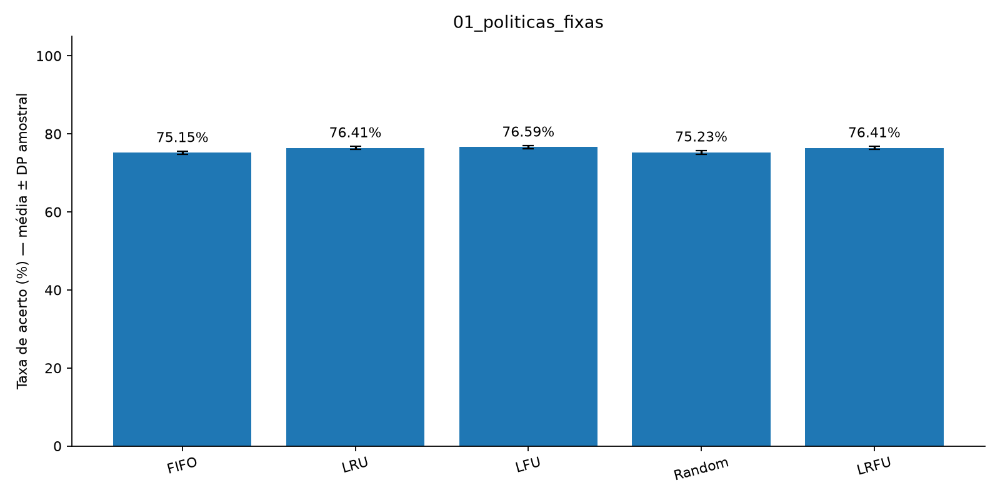

A maior média nesta configuração foi LFU, com 76,59%. Esse resultado se refere ao perfil base e não estabelece uma política universalmente melhor. A tabela pareada abaixo avalia as diferenças usando a mesma carga por repetição.

| Comparação (A − B) | Diferença (p.p.) | IC bootstrap 95% (p.p.) | A > B nas repetições |
|---|---|---|---|
| 01_politicas_fixas: FIFO - LRU | -1,254 | [-1,274; -1,236] | 0,00% |
| 01_politicas_fixas: LFU - LRU | 0,181 | [0,167; 0,196] | 100,00% |
| 01_politicas_fixas: Random - LRU | -1,173 | [-1,207; -1,139] | 0,00% |
| 01_politicas_fixas: LRFU - LRU | 0,006 | [0,004; 0,009] | 54,00% |

### 3.1 Extensão — nove blocos com capacidade fixa

A comparação das quatro políticas originais foi repetida para blocos de 2 a 512 B, com capacidade de 8 KiB fixa. Em cada tamanho de bloco, só a política muda. Entre tamanhos de bloco, o número de linhas muda como consequência da capacidade fixa.

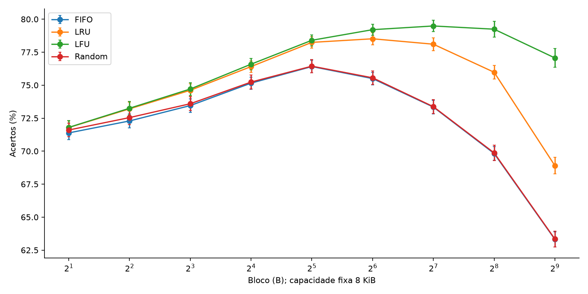

A maior média entre essas combinações foi LFU, bloco de 128 B, com 79,49%. Blocos maiores podem aproveitar vizinhança, mas deixam menos linhas disponíveis; o gráfico deve ser interpretado com esse compromisso.

## 4. Atividade 2 — Localidade temporal, espacial e regiões quentes

| Cenário | Política | Média | DP (p.p.) | Variância da fração | Mín.–máx. | Outliers |
|---|---|---|---|---|---|---|
| Aleatório | LRU | 0,77% | 0,086 | 0.00000073 | 0,62%–1,02% | 2 |
| Base | LRU | 76,41% | 0,436 | 0.00001903 | 74,74%–77,31% | 2 |
| Temporal alta | LRU | 87,37% | 0,425 | 0.00001804 | 85,90%–88,36% | 1 |
| Espacial alta | LRU | 78,24% | 0,654 | 0.00004282 | 76,52%–79,83% | 0 |
| Regiões quentes altas | LRU | 89,09% | 0,326 | 0.00001064 | 88,44%–90,01% | 1 |

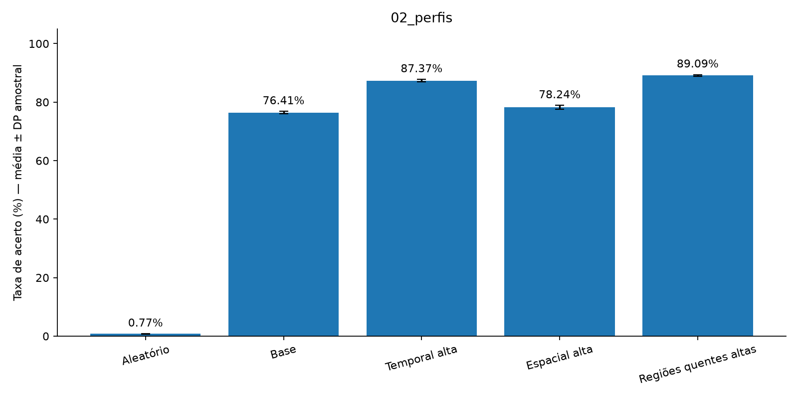

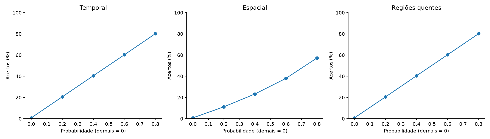

No estudo isolado de temporal, a média variou de 0,77% em p=0 para 80,14% em p=0,8. A diferença observada foi 79,37 pontos percentuais. O mecanismo complementar continua sendo o sorteio uniforme.

No estudo isolado de espacial, a média variou de 0,77% em p=0 para 57,22% em p=0,8. A diferença observada foi 56,45 pontos percentuais. O mecanismo complementar continua sendo o sorteio uniforme.

No estudo isolado de regiões quentes, a média variou de 0,77% em p=0 para 80,10% em p=0,8. A diferença observada foi 79,33 pontos percentuais. O mecanismo complementar continua sendo o sorteio uniforme.

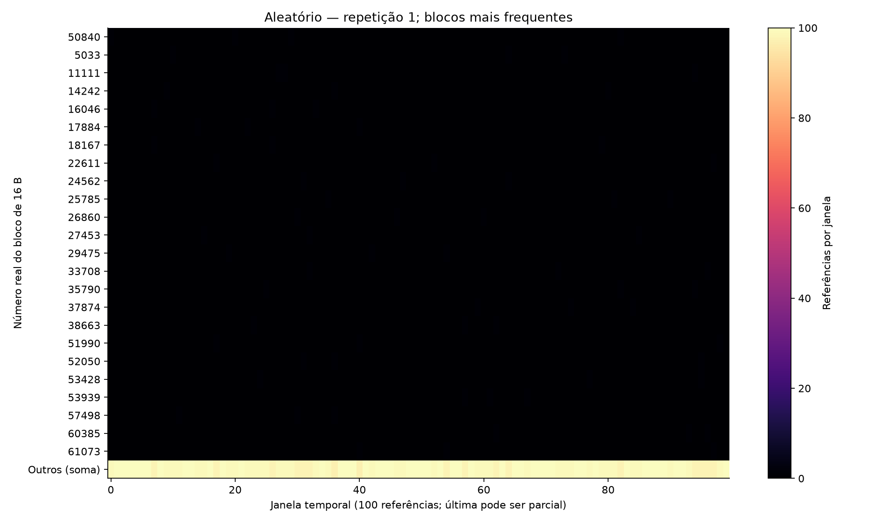

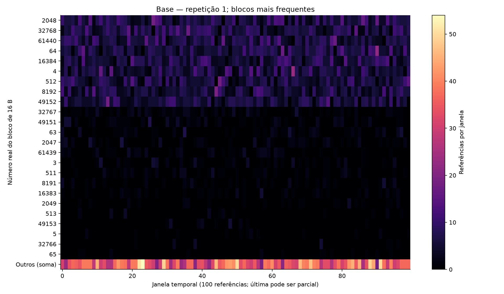

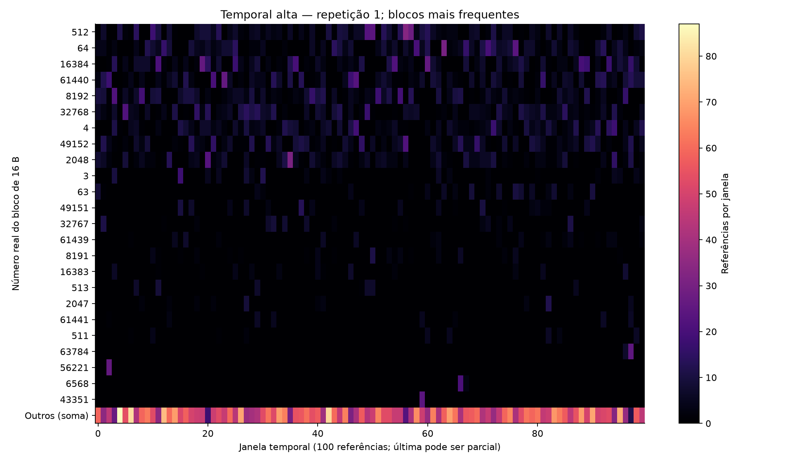

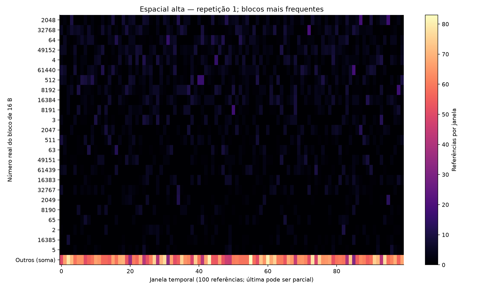

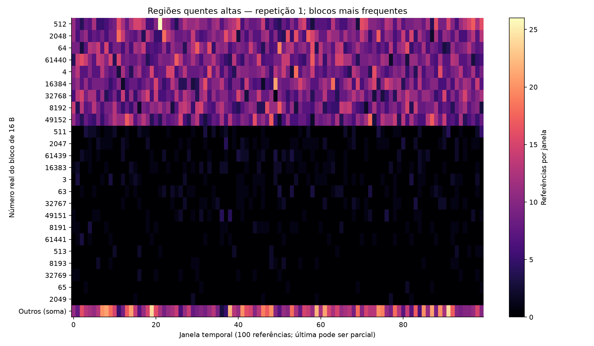

Os mapas foram gerados pela função `mapa_temporal_blocos()`, com a mesma carga da primeira repetição de cada perfil. O eixo vertical informa números reais de blocos de 16 B: não usa módulo nem mistura blocos distintos numa mesma linha identificada. São mostrados os 24 blocos mais frequentes; a última linha agrega todos os outros, portanto tem significado e escala de agregação diferentes. A última janela parcial é mantida. Cada coluna conserva o total de referências de sua janela.

Repetições temporais produzem concentração em trechos do tempo; acessos espaciais favorecem endereços próximos e podem permanecer no mesmo bloco ou em blocos vizinhos; regiões quentes fazem certos blocos reaparecerem em várias janelas. No padrão uniforme, não há um pequeno conjunto fixo de blocos intencionalmente privilegiado e a linha “Outros” concentra grande parte das referências. Os mapas ilustram a carga, não o conteúdo da cache nem cada hit/miss. Como cada painel escolhe seus próprios blocos mais frequentes, posições verticais não devem ser comparadas como se fossem o mesmo endereço.

## 5. Atividade 3 — Monte Carlo, distribuições e outliers

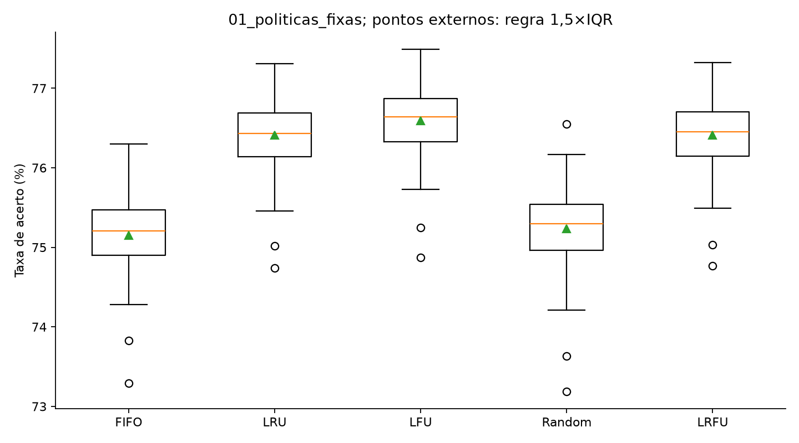

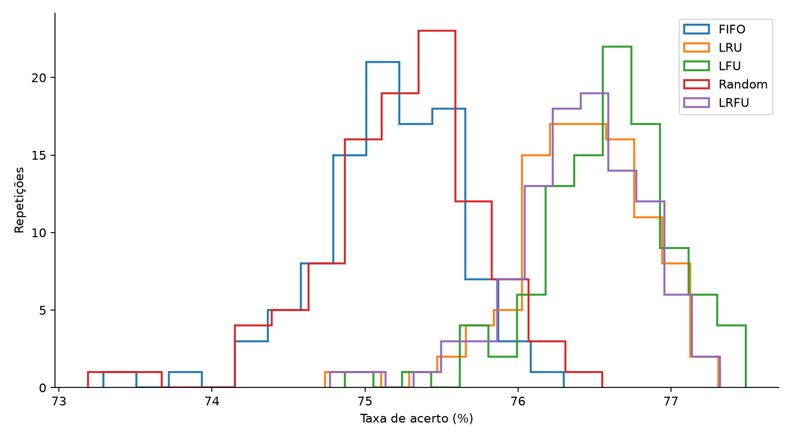

O boxplot mostra mediana, quartis, bigodes até as observações dentro de 1,5×IQR, média e pontos externos. Um outlier é uma repetição extrema segundo a regra, não necessariamente erro ou defeito do simulador. A robustez deve considerar simultaneamente média, dispersão, pior repetição e carga.

| Política | Mediana | Q1–Q3 | Pior repetição | Melhor repetição | Outliers |
|---|---|---|---|---|---|
| FIFO | 75,20% | 74,90%–75,47% | 73,29% | 76,30% | 2 |
| LRU | 76,43% | 76,14%–76,69% | 74,74% | 77,31% | 2 |
| LFU | 76,64% | 76,33%–76,87% | 74,87% | 77,49% | 2 |
| Random | 75,30% | 74,96%–75,54% | 73,19% | 76,55% | 3 |
| LRFU | 76,45% | 76,15%–76,70% | 74,77% | 77,32% | 2 |

O arquivo `outliers.csv` identifica cenário, semente, hits, misses e taxa de cada observação marcada; `resumo_estatistico.csv` registra os limites empregados. Não foram removidas observações. Os estudos de capacidade e associatividade da próxima seção também têm 100 repetições por cenário na execução final.

As piores repetições do perfil base foram FIFO: semente 2033, 73,29%; LRU: semente 2033, 74,74%; LFU: semente 2033, 74,87%; Random: semente 2033, 73,19%; LRFU: semente 2033, 74,77%. Como as cargas são pareadas, extremos compartilhados podem refletir a mesma sequência de acessos desfavorável. Não se atribui a causa de um extremo somente pela taxa agregada; o arquivo de outliers permite reproduzir a semente.

### 5.1 Robustez diante de mudanças de fase e varredura

Na carga de fases, 80% das referências visitam oito blocos quentes, que mudam na metade da execução; 20% fazem uma varredura. Os endereços são espaçados por 512 B para competir no mesmo conjunto da arquitetura de referência. Na carga de poluição, o conjunto quente é estável e ocupa 50% das referências; a outra metade faz varredura. São testes sintéticos adversariais e declarados, não rastros representativos de todos os programas.

| Cenário | Política | Média | DP (p.p.) | Variância da fração | Mín.–máx. | Outliers |
|---|---|---|---|---|---|---|
| FIFO | FIFO | 66,71% | 0,649 | 0.00004210 | 64,98%–68,87% | 1 |
| LRU | LRU | 78,02% | 0,572 | 0.00003268 | 76,54%–79,48% | 0 |
| LFU | LFU | 76,49% | 0,488 | 0.00002382 | 75,29%–77,95% | 1 |
| Random | Random | 66,69% | 0,722 | 0.00005216 | 64,61%–69,06% | 2 |
| LRFU | LRFU | 79,74% | 0,437 | 0.00001906 | 78,63%–81,05% | 2 |

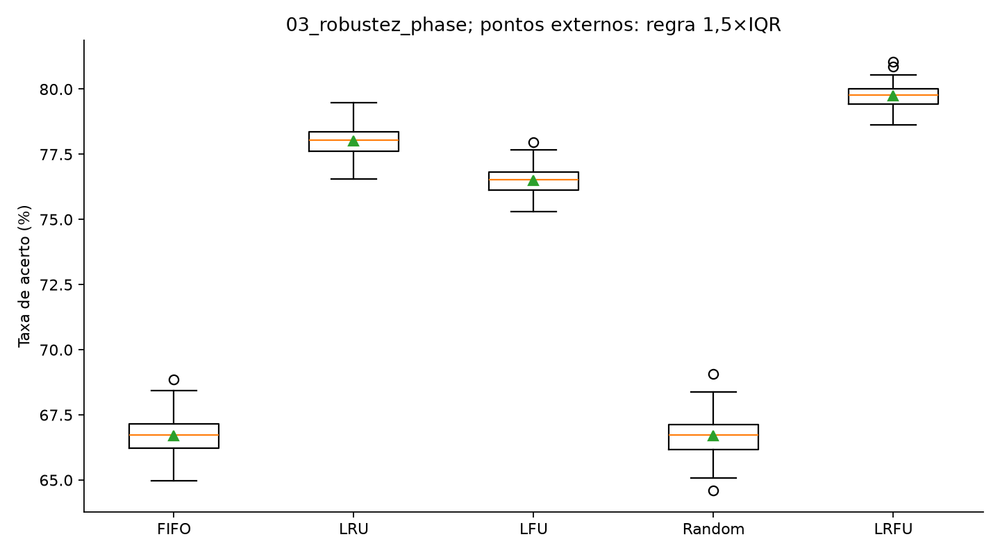

| Cenário | Política | Média | DP (p.p.) | Variância da fração | Mín.–máx. | Outliers |
|---|---|---|---|---|---|---|
| FIFO | FIFO | 29,77% | 0,567 | 0.00003212 | 28,58%–31,10% | 0 |
| LRU | LRU | 36,22% | 0,698 | 0.00004878 | 34,93%–38,03% | 1 |
| LFU | LFU | 49,92% | 0,524 | 0.00002745 | 48,59%–51,20% | 0 |
| Random | Random | 29,78% | 0,618 | 0.00003820 | 28,15%–31,85% | 1 |
| LRFU | LRFU | 49,91% | 0,523 | 0.00002740 | 48,58%–51,20% | 0 |

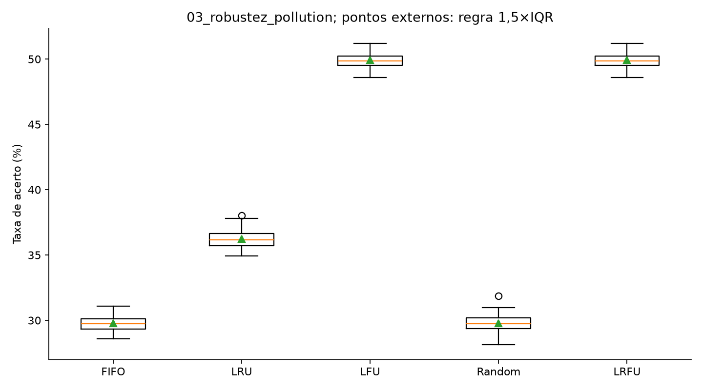

| Cenário | Política | Média | DP (p.p.) | Variância da fração | Mín.–máx. | Outliers |
|---|---|---|---|---|---|---|
| FIFO | FIFO | 0,77% | 0,085 | 0.00000072 | 0,62%–1,02% | 2 |
| LRU | LRU | 0,77% | 0,086 | 0.00000073 | 0,62%–1,02% | 2 |
| LFU | LFU | 0,77% | 0,090 | 0.00000081 | 0,60%–1,06% | 2 |
| Random | Random | 0,76% | 0,085 | 0.00000072 | 0,58%–0,97% | 0 |
| LRFU | LRFU | 0,77% | 0,086 | 0.00000074 | 0,62%–1,04% | 2 |

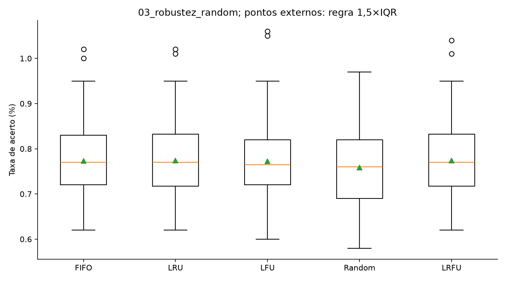

## 6. Atividade 4 — Influência dos parâmetros arquiteturais

### 6.1 Número de linhas

Variam-se 64, 128, 256, 512, 1.024 e 2.048 linhas. Bloco de 16 B e associatividade 16 permanecem fixos; a capacidade em bytes e o número de conjuntos mudam como consequências do número de linhas.

| Cenário | Política | Média | DP (p.p.) | Variância da fração | Mín.–máx. | Outliers |
|---|---|---|---|---|---|---|
| 64 | LRU | 73,47% | 0,508 | 0.00002584 | 71,56%–74,52% | 2 |
| 128 | LRU | 75,07% | 0,474 | 0.00002250 | 73,15%–76,04% | 2 |
| 256 | LRU | 75,92% | 0,454 | 0.00002061 | 74,05%–76,83% | 2 |
| 512 | LRU | 76,41% | 0,436 | 0.00001903 | 74,74%–77,31% | 2 |
| 1024 | LRU | 76,72% | 0,430 | 0.00001853 | 75,01%–77,53% | 2 |
| 2048 | LRU | 76,92% | 0,424 | 0.00001802 | 75,20%–77,73% | 2 |

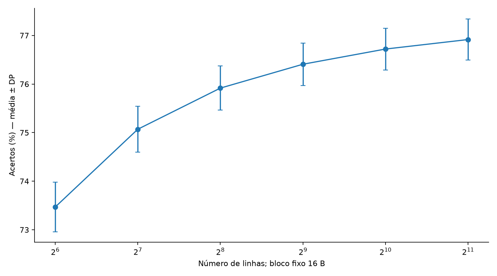

### 6.2 Associatividade e mapeamento

Mantêm-se 512 linhas de 16 B e capacidade de 8 KiB. Variam-se 1, 2, 4, 8, 16, 32, 64, 128, 256 e 512 vias. Uma via representa mapeamento direto; 512 vias, um único conjunto totalmente associativo; os valores intermediários são associativos por conjuntos. O número de conjuntos é 512 / vias.

| Cenário | Política | Média | DP (p.p.) | Variância da fração | Mín.–máx. | Outliers |
|---|---|---|---|---|---|---|
| 1 | LRU | 45,90% | 0,515 | 0.00002651 | 44,60%–47,05% | 0 |
| 2 | LRU | 51,11% | 0,489 | 0.00002395 | 49,93%–52,10% | 0 |
| 4 | LRU | 61,05% | 0,520 | 0.00002699 | 59,58%–62,22% | 2 |
| 8 | LRU | 74,75% | 0,489 | 0.00002396 | 72,84%–75,84% | 2 |
| 16 | LRU | 76,41% | 0,436 | 0.00001903 | 74,74%–77,31% | 2 |
| 32 | LRU | 76,51% | 0,432 | 0.00001862 | 74,84%–77,39% | 2 |
| 64 | LRU | 76,53% | 0,433 | 0.00001875 | 74,83%–77,39% | 2 |
| 128 | LRU | 76,54% | 0,434 | 0.00001884 | 74,85%–77,41% | 2 |
| 256 | LRU | 76,54% | 0,434 | 0.00001885 | 74,84%–77,42% | 2 |
| 512 | LRU | 76,54% | 0,433 | 0.00001875 | 74,85%–77,41% | 2 |

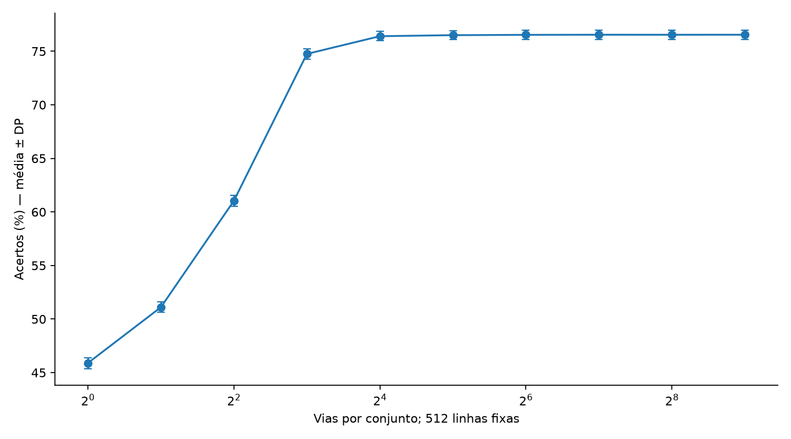

A associatividade pode aliviar conflitos de mapeamento, mas a curva depende dos endereços escolhidos e da política. O modelo não mede comparadores, área de silício, consumo ou latência de busca. Uma organização com maior taxa de acerto não é automaticamente a melhor implementação física.

### 6.3 Tamanho de bloco com linhas fixas

Mantêm-se 512 linhas e 16 vias; varia-se somente o tamanho de bloco como parâmetro independente. A capacidade em bytes passa de 1 KiB a 256 KiB como consequência. Esta pergunta é diferente do estudo com capacidade fixa da seção 3.1: não se pode manter simultaneamente capacidade, linhas e bloco constantes ao variar um deles.

| Cenário | Política | Média | DP (p.p.) | Variância da fração | Mín.–máx. | Outliers |
|---|---|---|---|---|---|---|
| 2 | LRU | 68,69% | 0,555 | 0.00003081 | 67,11%–70,16% | 2 |
| 4 | LRU | 71,65% | 0,561 | 0.00003151 | 69,57%–72,99% | 2 |
| 8 | LRU | 74,09% | 0,514 | 0.00002638 | 72,04%–75,27% | 3 |
| 16 | LRU | 76,41% | 0,436 | 0.00001903 | 74,74%–77,31% | 2 |
| 32 | LRU | 78,53% | 0,414 | 0.00001710 | 76,97%–79,39% | 3 |
| 64 | LRU | 79,65% | 0,394 | 0.00001551 | 78,21%–80,46% | 3 |
| 128 | LRU | 80,59% | 0,381 | 0.00001455 | 79,16%–81,57% | 3 |
| 256 | LRU | 81,87% | 0,374 | 0.00001398 | 80,36%–82,85% | 3 |
| 512 | LRU | 84,09% | 0,315 | 0.00000994 | 82,74%–84,74% | 2 |

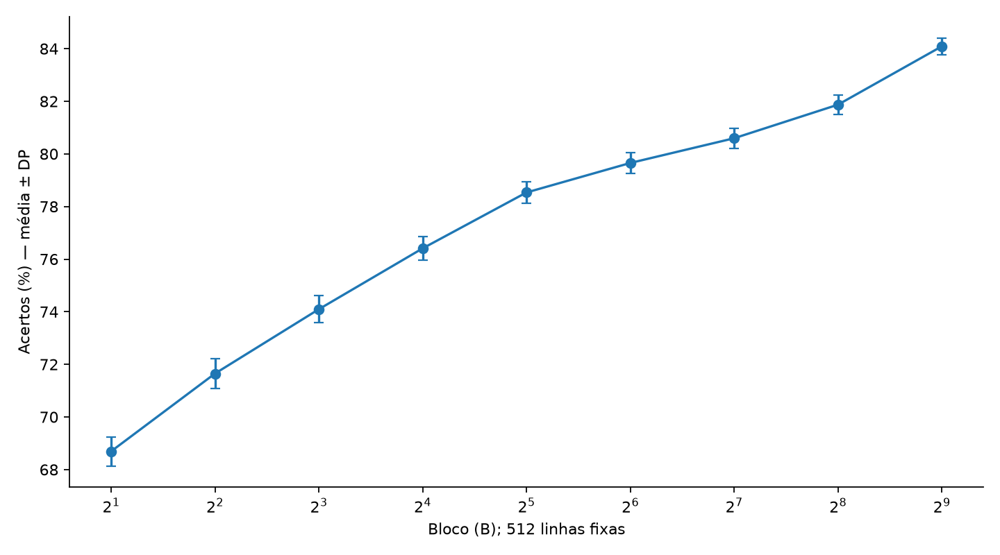

## 7. Atividade 5 — Extensão de política: LRFU didática

Foi implementada uma variante didática de frequência com envelhecimento, integrada à classe `EvictionPolicy`, à GUI e ao Monte Carlo. É uma implementação nova neste projeto de uma ideia conhecida; não se reivindica a invenção científica da família LRFU.

Em cada acesso residente, a pontuação é C(t) = 2^(−λ × (t − t_anterior)) × C(t_anterior) + 1. Na inserção, C=1. A política remove a menor pontuação envelhecida, com desempate por recência e inserção. λ=1/64 significa meia-vida de 64 referências globais, incluindo acessos a outros conjuntos. Na seleção, comparar log2(C) + λ×t_anterior evita subfluxo e dispensa atualizar todas as linhas a cada acesso. O termo −λ×t_atual é comum às candidatas e se cancela.

A hipótese é preservar blocos frequentes sem manter indefinidamente a influência de uma fase antiga. λ=0 reduz a frequência sem envelhecimento (LFU com o mesmo desempate); meias-vidas menores privilegiam comportamento recente. A escolha da meia-vida é um parâmetro da política, não uma constante universal.

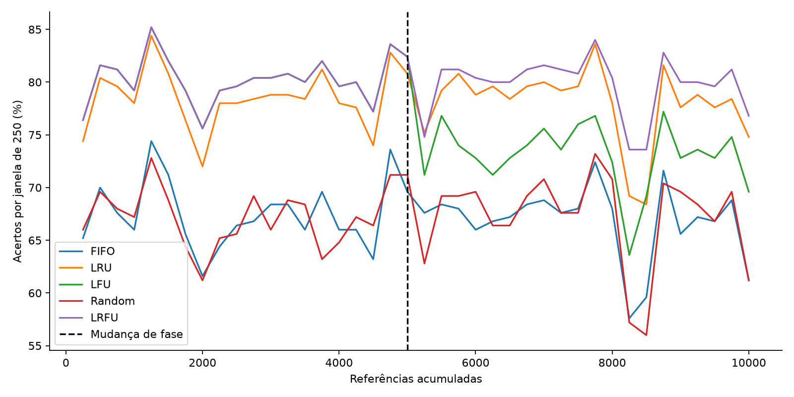

| Comparação (A − B) | Diferença (p.p.) | IC bootstrap 95% (p.p.) | A > B nas repetições |
|---|---|---|---|
| 03_robustez_phase: FIFO - LRU | -11,313 | [-11,352; -11,274] | 0,00% |
| 03_robustez_phase: LFU - LRU | -1,532 | [-1,571; -1,493] | 0,00% |
| 03_robustez_phase: Random - LRU | -11,326 | [-11,401; -11,248] | 0,00% |
| 03_robustez_phase: LRFU - LRU | 1,720 | [1,685; 1,755] | 100,00% |
| 03_robustez_pollution: FIFO - LRU | -6,448 | [-6,491; -6,403] | 0,00% |
| 03_robustez_pollution: LFU - LRU | 13,694 | [13,647; 13,741] | 100,00% |
| 03_robustez_pollution: Random - LRU | -6,439 | [-6,513; -6,364] | 0,00% |
| 03_robustez_pollution: LRFU - LRU | 13,692 | [13,645; 13,740] | 100,00% |
| 03_robustez_random: FIFO - LRU | -0,001 | [-0,002; 0,001] | 18,00% |
| 03_robustez_random: LFU - LRU | -0,002 | [-0,009; 0,005] | 42,00% |
| 03_robustez_random: Random - LRU | -0,016 | [-0,029; -0,002] | 40,00% |
| 03_robustez_random: LRFU - LRU | 0,000 | [-0,000; 0,001] | 2,00% |

| Cenário | Política | Média | DP (p.p.) | Variância da fração | Mín.–máx. | Outliers |
|---|---|---|---|---|---|---|
| 8 | LRFU | 78,88% | 0,512 | 0.00002617 | 77,46%–80,29% | 1 |
| 32 | LRFU | 79,79% | 0,435 | 0.00001895 | 78,65%–81,08% | 4 |
| 128 | LRFU | 79,60% | 0,450 | 0.00002025 | 78,39%–80,98% | 2 |
| 512 | LRFU | 78,32% | 0,500 | 0.00002503 | 77,07%–79,83% | 1 |

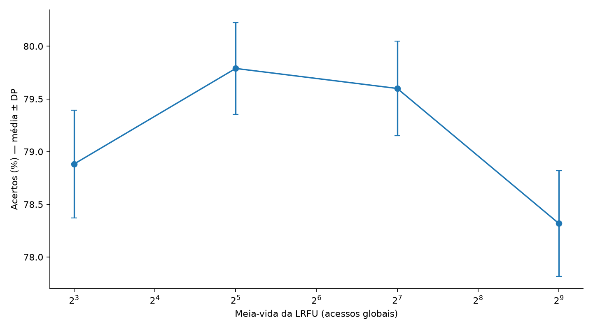

O estudo de sensibilidade usa as mesmas sementes da carga de fases. Serve para mostrar dependência do parâmetro, sem tratar o melhor valor observado como ajuste validado em dados independentes. LFU e LRFU exigem metadados e seleção de vítima mais complexos que FIFO; os tempos Python não são custos de hardware. Na implementação, seleção LFU/LRFU percorre as vias em uma substituição; FIFO/LRU mantêm ordem explicitamente.

Na carga base, LRFU obteve 76,41%, enquanto LFU obteve 76,59%; a diferença descritiva LRFU menos LFU é -0,17 p.p. Após introduzir a carga de fases, as médias foram 79,74% para LRFU e 76,49% para LFU, diferença de 3,25 p.p. Esses contrastes tornam explícitos os ganhos e perdas da política em vez de selecionar apenas um cenário favorável. Os ICs apresentados usam LRU como referência.

## 8. Atividade 6 — Acesso realista versus aleatório

| Cenário | Política | Média | DP (p.p.) | Variância da fração | Mín.–máx. | Outliers |
|---|---|---|---|---|---|---|
| Realista | LRU | 76,41% | 0,436 | 0.00001903 | 74,74%–77,31% | 2 |
| Aleatório | LRU | 0,77% | 0,086 | 0.00000073 | 0,62%–1,02% | 2 |

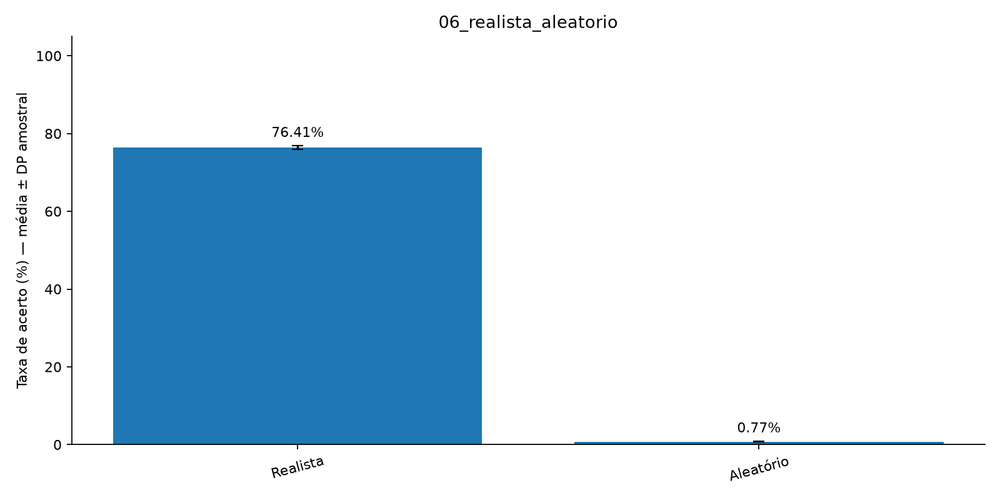

Com a mesma arquitetura LRU, o realista obteve 76,41% e o uniforme 0,77%: diferença de 75,63 pontos percentuais. A explicação é a reutilização e concentração intencionais do modelo; os mapas correspondentes são os painéis Aleatório e Base da seção 4.

Como referência de ordem de grandeza, 8 KiB / 1 MiB = 0,78125% é a fração da memória que cabe na cache. Sob acesso uniforme independente, uma cache já ocupada tende a uma probabilidade de acerto dessa ordem. A partida fria e o rastro finito afetam o valor observado.

## 9. Além do roteiro — Filtro FIR multicanal

Foi modelado um FIR de oito coeficientes em um sinal com 128 amostras e 32 canais, armazenado em ordem amostra × canal (row-major), com elementos float32 de quatro bytes. Para cada par de saída (n,c), calcula-se y[n−7,c] = soma de h[k]×x[n−k,c], para k de 0 a 7. Há 121×32 saídas válidas.

Duas versões executam exatamente os mesmos produtos e somas na mesma ordem interna: (A) canal externo e amostra interna; (B) amostra externa e canal interno. A versão B visita canais contíguos antes de avançar o tempo. Cada multiplicação-acumulação gera uma leitura de x e uma de h; cada saída gera uma escrita de y. O acumulador fica em registrador. Assim, cada rastro completo tem 121×32×17 = 65.824 referências. Não há truncamento para 10.000 referências.

As 100 repetições variam os deslocamentos alinhados a 64 B das bases de entrada, coeficientes e saída, em regiões separadas da RAM. As versões e políticas compartilham o mesmo layout em cada par. As distribuições refletem variabilidade de layout e mapeamento, não 100 sinais independentes com valores influenciando os acessos. O teste numérico usa dados float32 e confere igualdade exata entre as duas ordens e concordância com convolução de referência.

| Cenário | Política | Média | DP (p.p.) | Variância da fração | Mín.–máx. | Outliers |
|---|---|---|---|---|---|---|
| Canal externo; LRU | LRU | 87,89% | 0,000 | 0.00000000 | 87,89%–87,89% | 0 |
| Canal externo; LRFU | LRFU | 87,89% | 0,000 | 0.00000000 | 87,89%–87,89% | 0 |
| Amostra externa; LRU | LRU | 96,97% | 0,000 | 0.00000000 | 96,97%–96,97% | 0 |
| Amostra externa; LRFU | LRFU | 96,97% | 0,000 | 0.00000000 | 96,97%–96,97% | 0 |

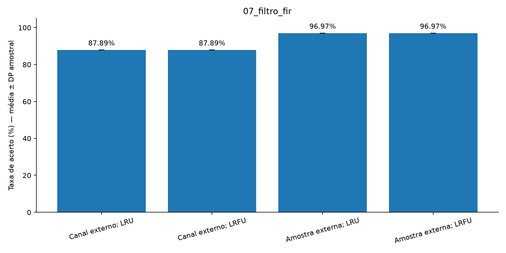

| Comparação (A − B) | Diferença (p.p.) | IC bootstrap 95% (p.p.) | A > B nas repetições |
|---|---|---|---|
| FIR LRU: amostra - canal | 9,079 | [9,079; 9,079] | 100,00% |
| FIR LRFU: amostra - canal | 9,079 | [9,079; 9,079] | 100,00% |

Este é um rastro derivado de um algoritmo concreto, não uma captura de endereços de uma CPU real. O modelo não inclui instruções, prefetch, vetorização, políticas reais de escrita ou otimizações do compilador. A escrita é contada como uma referência com alocação em miss, sem custo de writeback. Consequentemente, os resultados medem o efeito da ordem de referências na taxa de acerto desse modelo.

Na LRU, a troca de ordem levou a média de 87,89% para 96,97%: 9,08 pontos percentuais de acertos a mais e 74,98% de redução relativa da taxa de misses. Isso não significa a mesma redução de tempo de execução. Avançar uma amostra do mesmo canal salta 128 B (32 canais × 4 B), ou oito blocos de 16 B; com 32 conjuntos, essa progressão visita apenas quatro índices por posição de canal. Esse padrão favorece pressão concentrada nos conjuntos. Percorrer canais contíguos aproveita os quatro elementos float32 que cabem em cada bloco e aproxima reutilizações.

## 10. Além do roteiro — Classificação de misses por referência 3C

O estudo adicional usa apenas LRU e mantém uma cache sombra totalmente associativa LRU com a mesma capacidade e bloco. Se um bloco nunca foi visto, seu miss é compulsório. Para misses restantes, um hit na sombra é rotulado conflito; um miss também na sombra é rotulado capacidade. Trata-se de classificação em relação ao contrafactual FA-LRU, que pode incorporar interações entre organização e histórico; não é uma identificação física independente de cada causa.

| Carga e organização | Hits médios | Misses compulsórios | Conflito (referência FA-LRU) | Capacidade |
|---|---|---|---|---|
| Realista por conjuntos | 7640,78 | 2304,99 | 15,73 | 38,50 |
| Aleatório por conjuntos | 77,42 | 9273,80 | 7,51 | 641,27 |
| Fases por conjuntos | 7802,00 | 925,47 | 886,53 | 386,00 |
| Fases totalmente associativa | 8688,53 | 925,47 | 0,00 | 386,00 |

A soma hits + compulsórios + conflito + capacidade foi verificada contra o total de referências em cada repetição. Na própria cache totalmente associativa LRU, os conflitos por essa definição são zero. A comparação da carga de fases por conjuntos com a totalmente associativa ajuda a distinguir a pressão de um conjunto específico da ocupação global.

## 11. Verificação e limites

- Políticas comparadas acesso a acesso com um modelo independente simples, incluindo o cálculo LRFU pela soma explícita das contribuições do histórico residente.

- Endereçamento conferido por reconstrução tag/conjunto/offset; configurações inválidas rejeitadas; contadores e partida fria conferidos.

- Reprodução de amostras históricas das quatro políticas originais, incluindo a sequência global original de Random.

- Mesmas cargas garantidas entre políticas e RNGs separados; equivalência de multiconjunto de referências e de resultado numérico do FIR.

- Testes de casos conhecidos de misses compulsórios, de conflito e de capacidade.

O estudo não mede latências, ciclos de CPU, energia, hierarquia multinível ou desempenho de hardware real. A memória de dados é byte-endereçada, e não se modelam valores armazenados, exceto no teste de equivalência numérica do FIR. O aquecimento não é descartado: os resultados incluem partida fria. As sementes reproduzem os cenários neste ambiente, mas resultados de RNG e bibliotecas podem depender da versão; consulte o manifesto.

Cenários com os mesmos parâmetros reaparecem como controles em atividades diferentes. Não devem ser somados como amostras independentes. No FIR, a troca de laços é controlada, porém o rastro não é extraído de um executável. A análise LRFU é exploratória em cargas escolhidas para observar frequência e adaptação; bons resultados nelas não validam superioridade universal.

No estudo de número de linhas, a média passou de 73,47% no primeiro valor testado para 76,92% no último; a maior média observada foi 76,92%, em 2048. Isso descreve esta carga, sem presumir crescimento estritamente monotônico nem benefício universal.

No estudo de associatividade, a média passou de 45,90% no primeiro valor testado para 76,54% no último; a maior média observada foi 76,54%, em 512. Isso descreve esta carga, sem presumir crescimento estritamente monotônico nem benefício universal.

No estudo de bloco com linhas fixas, a média passou de 68,69% no primeiro valor testado para 84,09% no último; a maior média observada foi 84,09%, em 512. Isso descreve esta carga, sem presumir crescimento estritamente monotônico nem benefício universal.

## 12. Conclusões

Na carga 03_robustez_random, a maior média foi LRFU (0,77%), e a menor, Random (0,76%).

Na carga 03_robustez_pollution, a maior média foi LFU (49,92%), e a menor, FIFO (29,77%).

Na carga 03_robustez_phase, a maior média foi LRFU (79,74%), e a menor, Random (66,69%).

Na arquitetura fixa e perfil base, a maior média foi LFU (76,59%). Nos nove blocos com capacidade fixa e políticas originais, destacou-se LFU com 128 B (79,49%). A conclusão prática deve considerar a carga, a dispersão e os compromissos de organização, e não apenas o maior número de uma tabela.

A localidade e a ordem das referências são variáveis centrais do estudo. Os experimentos separados de linhas, associatividade e bloco explicitam quais quantidades são controladas e quais mudam como consequência. A política LRFU acrescenta uma forma de balancear frequência e recência, com sensibilidade mensurável ao envelhecimento. O FIR fornece um exemplo verificável de como investigar uma otimização de programa através do modelo de cache.

As seis atividades foram cobertas, e as extensões acrescentam comparações pareadas, envelhecimento parametrizado, comportamento temporal após mudança de fase, classificação por cache sombra, validação por modelo de referência e um caso de processamento digital de sinais. Todos os números desta versão são gerados dos resultados efetivamente executados.

## 13. Matriz de atendimento

| Item | Entrega |
|---|---|
| 1 — Algoritmos | Arquitetura fixa, gráfico por política, comparação pareada e discussão; seção 3 |
| 2 — Localidade | Perfis compostos, variação isolada, cinco mapas de blocos reais; seção 4 |
| 3 — Monte Carlo | 100 repetições, CSV individual, quartis, variância, histogramas, boxplots e outliers; seção 5 |
| 4 — Arquitetura | Linhas, vias e bloco em estudos separados; direta, conjuntos e totalmente associativa; seção 6 |
| 5 — Nova política | LRFU integrada ao núcleo e GUI; comparação Monte Carlo e sensibilidade; seção 7 |
| 6 — Realista/aleatório | Comparação controlada e interpretação dos mapas; seção 8 |
| Extensões | Fases, varredura, IC pareado, FIR multicanal, 3C, checkpoints e testes; seções 5, 7, 9 e 10 |

## Referências

OLIVEIRA, José Paulo Gonçalves de. *Simulador de Memória Cache — Projeto acadêmico*. Material fornecido na disciplina, arquivo README_Simulador_Memoria_Cache.pdf, 16 páginas. Foram usados a descrição do núcleo, a simulação Monte Carlo, as limitações e o princípio de experimentação controlada (p. 13–14).

OLIVEIRA, José Paulo G. de. *Sistemas Computacionais e Sistemas Embarcados de Tempo Real — Projetos com FreeRTOS*. Seção 4.10, “Memória cache”, arquivo Memória cache - teoria.pdf fornecido na disciplina, p. 216 e seguintes. Dados editoriais completos não constam no recorte consultado.

Roteiro de seis atividades práticas fornecido pelo professor e transcrito pela equipe. As expressões e implementações adicionais deste projeto são descritas nas seções correspondentes; não se atribui aos materiais a especificação dos experimentos adicionais.

## Apêndice A — Todos os cenários

| ID | Experimento / cenário | Política | Cache B | Linhas | Bloco B | Vias | Média | DP p.p. |
|---|---|---|---|---|---|---|---|---|
| C001 | 01_politicas_fixas / FIFO | FIFO | 8192 | 512 | 16 | 16 | 75,15% | 0,459 |
| C002 | 01_politicas_fixas / LRU | LRU | 8192 | 512 | 16 | 16 | 76,41% | 0,436 |
| C003 | 01_politicas_fixas / LFU | LFU | 8192 | 512 | 16 | 16 | 76,59% | 0,437 |
| C004 | 01_politicas_fixas / Random | Random | 8192 | 512 | 16 | 16 | 75,23% | 0,524 |
| C005 | 01_politicas_fixas / LRFU | LRFU | 8192 | 512 | 16 | 16 | 76,41% | 0,433 |
| C006 | 01b_politicas_blocos / FIFO; 2 B | FIFO | 8192 | 4096 | 2 | 16 | 71,38% | 0,524 |
| C007 | 01b_politicas_blocos / FIFO; 4 B | FIFO | 8192 | 2048 | 4 | 16 | 72,29% | 0,527 |
| C008 | 01b_politicas_blocos / FIFO; 8 B | FIFO | 8192 | 1024 | 8 | 16 | 73,45% | 0,514 |
| C009 | 01b_politicas_blocos / FIFO; 16 B | FIFO | 8192 | 512 | 16 | 16 | 75,15% | 0,459 |
| C010 | 01b_politicas_blocos / FIFO; 32 B | FIFO | 8192 | 256 | 32 | 16 | 76,41% | 0,469 |
| C011 | 01b_politicas_blocos / FIFO; 64 B | FIFO | 8192 | 128 | 64 | 16 | 75,50% | 0,480 |
| C012 | 01b_politicas_blocos / FIFO; 128 B | FIFO | 8192 | 64 | 128 | 16 | 73,34% | 0,512 |
| C013 | 01b_politicas_blocos / FIFO; 256 B | FIFO | 8192 | 32 | 256 | 16 | 69,82% | 0,518 |
| C014 | 01b_politicas_blocos / FIFO; 512 B | FIFO | 8192 | 16 | 512 | 16 | 63,32% | 0,566 |
| C015 | 01b_politicas_blocos / LRU; 2 B | LRU | 8192 | 4096 | 2 | 16 | 71,79% | 0,510 |
| C016 | 01b_politicas_blocos / LRU; 4 B | LRU | 8192 | 2048 | 4 | 16 | 73,21% | 0,516 |
| C017 | 01b_politicas_blocos / LRU; 8 B | LRU | 8192 | 1024 | 8 | 16 | 74,61% | 0,493 |
| C018 | 01b_politicas_blocos / LRU; 16 B | LRU | 8192 | 512 | 16 | 16 | 76,41% | 0,436 |
| C019 | 01b_politicas_blocos / LRU; 32 B | LRU | 8192 | 256 | 32 | 16 | 78,24% | 0,426 |
| C020 | 01b_politicas_blocos / LRU; 64 B | LRU | 8192 | 128 | 64 | 16 | 78,51% | 0,450 |
| C021 | 01b_politicas_blocos / LRU; 128 B | LRU | 8192 | 64 | 128 | 16 | 78,10% | 0,481 |
| C022 | 01b_politicas_blocos / LRU; 256 B | LRU | 8192 | 32 | 256 | 16 | 75,98% | 0,521 |
| C023 | 01b_politicas_blocos / LRU; 512 B | LRU | 8192 | 16 | 512 | 16 | 68,90% | 0,623 |
| C024 | 01b_politicas_blocos / LFU; 2 B | LFU | 8192 | 4096 | 2 | 16 | 71,80% | 0,507 |
| C025 | 01b_politicas_blocos / LFU; 4 B | LFU | 8192 | 2048 | 4 | 16 | 73,25% | 0,513 |
| C026 | 01b_politicas_blocos / LFU; 8 B | LFU | 8192 | 1024 | 8 | 16 | 74,71% | 0,485 |
| C027 | 01b_politicas_blocos / LFU; 16 B | LFU | 8192 | 512 | 16 | 16 | 76,59% | 0,437 |
| C028 | 01b_politicas_blocos / LFU; 32 B | LFU | 8192 | 256 | 32 | 16 | 78,40% | 0,420 |
| C029 | 01b_politicas_blocos / LFU; 64 B | LFU | 8192 | 128 | 64 | 16 | 79,20% | 0,414 |
| C030 | 01b_politicas_blocos / LFU; 128 B | LFU | 8192 | 64 | 128 | 16 | 79,49% | 0,440 |
| C031 | 01b_politicas_blocos / LFU; 256 B | LFU | 8192 | 32 | 256 | 16 | 79,24% | 0,600 |
| C032 | 01b_politicas_blocos / LFU; 512 B | LFU | 8192 | 16 | 512 | 16 | 77,06% | 0,715 |
| C033 | 01b_politicas_blocos / Random; 2 B | Random | 8192 | 4096 | 2 | 16 | 71,60% | 0,521 |
| C034 | 01b_politicas_blocos / Random; 4 B | Random | 8192 | 2048 | 4 | 16 | 72,54% | 0,542 |
| C035 | 01b_politicas_blocos / Random; 8 B | Random | 8192 | 1024 | 8 | 16 | 73,59% | 0,525 |
| C036 | 01b_politicas_blocos / Random; 16 B | Random | 8192 | 512 | 16 | 16 | 75,23% | 0,524 |
| C037 | 01b_politicas_blocos / Random; 32 B | Random | 8192 | 256 | 32 | 16 | 76,44% | 0,513 |
| C038 | 01b_politicas_blocos / Random; 64 B | Random | 8192 | 128 | 64 | 16 | 75,56% | 0,517 |
| C039 | 01b_politicas_blocos / Random; 128 B | Random | 8192 | 64 | 128 | 16 | 73,37% | 0,532 |
| C040 | 01b_politicas_blocos / Random; 256 B | Random | 8192 | 32 | 256 | 16 | 69,87% | 0,581 |
| C041 | 01b_politicas_blocos / Random; 512 B | Random | 8192 | 16 | 512 | 16 | 63,34% | 0,593 |
| C042 | 02_perfis / Aleatório | LRU | 8192 | 512 | 16 | 16 | 0,77% | 0,086 |
| C043 | 02_perfis / Base | LRU | 8192 | 512 | 16 | 16 | 76,41% | 0,436 |
| C044 | 02_perfis / Temporal alta | LRU | 8192 | 512 | 16 | 16 | 87,37% | 0,425 |
| C045 | 02_perfis / Espacial alta | LRU | 8192 | 512 | 16 | 16 | 78,24% | 0,654 |
| C046 | 02_perfis / Regiões quentes altas | LRU | 8192 | 512 | 16 | 16 | 89,09% | 0,326 |
| C047 | 02_isolada_0 / 0.0 | LRU | 8192 | 512 | 16 | 16 | 0,77% | 0,086 |
| C048 | 02_isolada_0 / 0.2 | LRU | 8192 | 512 | 16 | 16 | 20,64% | 0,413 |
| C049 | 02_isolada_0 / 0.4 | LRU | 8192 | 512 | 16 | 16 | 40,48% | 0,551 |
| C050 | 02_isolada_0 / 0.6 | LRU | 8192 | 512 | 16 | 16 | 60,22% | 0,439 |
| C051 | 02_isolada_0 / 0.8 | LRU | 8192 | 512 | 16 | 16 | 80,14% | 0,368 |
| C052 | 02_isolada_1 / 0.0 | LRU | 8192 | 512 | 16 | 16 | 0,77% | 0,086 |
| C053 | 02_isolada_1 / 0.2 | LRU | 8192 | 512 | 16 | 16 | 11,18% | 0,344 |
| C054 | 02_isolada_1 / 0.4 | LRU | 8192 | 512 | 16 | 16 | 23,28% | 0,453 |
| C055 | 02_isolada_1 / 0.6 | LRU | 8192 | 512 | 16 | 16 | 38,02% | 0,482 |
| C056 | 02_isolada_1 / 0.8 | LRU | 8192 | 512 | 16 | 16 | 57,22% | 0,537 |
| C057 | 02_isolada_2 / 0.0 | LRU | 8192 | 512 | 16 | 16 | 0,77% | 0,086 |
| C058 | 02_isolada_2 / 0.2 | LRU | 8192 | 512 | 16 | 16 | 20,49% | 0,432 |
| C059 | 02_isolada_2 / 0.4 | LRU | 8192 | 512 | 16 | 16 | 40,42% | 0,581 |
| C060 | 02_isolada_2 / 0.6 | LRU | 8192 | 512 | 16 | 16 | 60,23% | 0,501 |
| C061 | 02_isolada_2 / 0.8 | LRU | 8192 | 512 | 16 | 16 | 80,10% | 0,418 |
| C062 | 03_robustez_phase / FIFO | FIFO | 8192 | 512 | 16 | 16 | 66,71% | 0,649 |
| C063 | 03_robustez_phase / LRU | LRU | 8192 | 512 | 16 | 16 | 78,02% | 0,572 |
| C064 | 03_robustez_phase / LFU | LFU | 8192 | 512 | 16 | 16 | 76,49% | 0,488 |
| C065 | 03_robustez_phase / Random | Random | 8192 | 512 | 16 | 16 | 66,69% | 0,722 |
| C066 | 03_robustez_phase / LRFU | LRFU | 8192 | 512 | 16 | 16 | 79,74% | 0,437 |
| C067 | 03_robustez_pollution / FIFO | FIFO | 8192 | 512 | 16 | 16 | 29,77% | 0,567 |
| C068 | 03_robustez_pollution / LRU | LRU | 8192 | 512 | 16 | 16 | 36,22% | 0,698 |
| C069 | 03_robustez_pollution / LFU | LFU | 8192 | 512 | 16 | 16 | 49,92% | 0,524 |
| C070 | 03_robustez_pollution / Random | Random | 8192 | 512 | 16 | 16 | 29,78% | 0,618 |
| C071 | 03_robustez_pollution / LRFU | LRFU | 8192 | 512 | 16 | 16 | 49,91% | 0,523 |
| C072 | 03_robustez_random / FIFO | FIFO | 8192 | 512 | 16 | 16 | 0,77% | 0,085 |
| C073 | 03_robustez_random / LRU | LRU | 8192 | 512 | 16 | 16 | 0,77% | 0,086 |
| C074 | 03_robustez_random / LFU | LFU | 8192 | 512 | 16 | 16 | 0,77% | 0,090 |
| C075 | 03_robustez_random / Random | Random | 8192 | 512 | 16 | 16 | 0,76% | 0,085 |
| C076 | 03_robustez_random / LRFU | LRFU | 8192 | 512 | 16 | 16 | 0,77% | 0,086 |
| C077 | 04_linhas / 64 | LRU | 1024 | 64 | 16 | 16 | 73,47% | 0,508 |
| C078 | 04_linhas / 128 | LRU | 2048 | 128 | 16 | 16 | 75,07% | 0,474 |
| C079 | 04_linhas / 256 | LRU | 4096 | 256 | 16 | 16 | 75,92% | 0,454 |
| C080 | 04_linhas / 512 | LRU | 8192 | 512 | 16 | 16 | 76,41% | 0,436 |
| C081 | 04_linhas / 1024 | LRU | 16384 | 1024 | 16 | 16 | 76,72% | 0,430 |
| C082 | 04_linhas / 2048 | LRU | 32768 | 2048 | 16 | 16 | 76,92% | 0,424 |
| C083 | 04_associatividade / 1 | LRU | 8192 | 512 | 16 | 1 | 45,90% | 0,515 |
| C084 | 04_associatividade / 2 | LRU | 8192 | 512 | 16 | 2 | 51,11% | 0,489 |
| C085 | 04_associatividade / 4 | LRU | 8192 | 512 | 16 | 4 | 61,05% | 0,520 |
| C086 | 04_associatividade / 8 | LRU | 8192 | 512 | 16 | 8 | 74,75% | 0,489 |
| C087 | 04_associatividade / 16 | LRU | 8192 | 512 | 16 | 16 | 76,41% | 0,436 |
| C088 | 04_associatividade / 32 | LRU | 8192 | 512 | 16 | 32 | 76,51% | 0,432 |
| C089 | 04_associatividade / 64 | LRU | 8192 | 512 | 16 | 64 | 76,53% | 0,433 |
| C090 | 04_associatividade / 128 | LRU | 8192 | 512 | 16 | 128 | 76,54% | 0,434 |
| C091 | 04_associatividade / 256 | LRU | 8192 | 512 | 16 | 256 | 76,54% | 0,434 |
| C092 | 04_associatividade / 512 | LRU | 8192 | 512 | 16 | 512 | 76,54% | 0,433 |
| C093 | 04_bloco_linhas_fixas / 2 | LRU | 1024 | 512 | 2 | 16 | 68,69% | 0,555 |
| C094 | 04_bloco_linhas_fixas / 4 | LRU | 2048 | 512 | 4 | 16 | 71,65% | 0,561 |
| C095 | 04_bloco_linhas_fixas / 8 | LRU | 4096 | 512 | 8 | 16 | 74,09% | 0,514 |
| C096 | 04_bloco_linhas_fixas / 16 | LRU | 8192 | 512 | 16 | 16 | 76,41% | 0,436 |
| C097 | 04_bloco_linhas_fixas / 32 | LRU | 16384 | 512 | 32 | 16 | 78,53% | 0,414 |
| C098 | 04_bloco_linhas_fixas / 64 | LRU | 32768 | 512 | 64 | 16 | 79,65% | 0,394 |
| C099 | 04_bloco_linhas_fixas / 128 | LRU | 65536 | 512 | 128 | 16 | 80,59% | 0,381 |
| C100 | 04_bloco_linhas_fixas / 256 | LRU | 131072 | 512 | 256 | 16 | 81,87% | 0,374 |
| C101 | 04_bloco_linhas_fixas / 512 | LRU | 262144 | 512 | 512 | 16 | 84,09% | 0,315 |
| C102 | 06_realista_aleatorio / Realista | LRU | 8192 | 512 | 16 | 16 | 76,41% | 0,436 |
| C103 | 06_realista_aleatorio / Aleatório | LRU | 8192 | 512 | 16 | 16 | 0,77% | 0,086 |
| C104 | 07_filtro_fir / Canal externo; LRU | LRU | 8192 | 512 | 16 | 16 | 87,89% | 0,000 |
| C105 | 07_filtro_fir / Canal externo; LRFU | LRFU | 8192 | 512 | 16 | 16 | 87,89% | 0,000 |
| C106 | 07_filtro_fir / Amostra externa; LRU | LRU | 8192 | 512 | 16 | 16 | 96,97% | 0,000 |
| C107 | 07_filtro_fir / Amostra externa; LRFU | LRFU | 8192 | 512 | 16 | 16 | 96,97% | 0,000 |
| C108 | 08_sensibilidade_lrfu / 8 | LRFU | 8192 | 512 | 16 | 16 | 78,88% | 0,512 |
| C109 | 08_sensibilidade_lrfu / 32 | LRFU | 8192 | 512 | 16 | 16 | 79,79% | 0,435 |
| C110 | 08_sensibilidade_lrfu / 128 | LRFU | 8192 | 512 | 16 | 16 | 79,60% | 0,450 |
| C111 | 08_sensibilidade_lrfu / 512 | LRFU | 8192 | 512 | 16 | 16 | 78,32% | 0,500 |

## Apêndice B — Arquivos e reprodução

- [Resultados individuais](resultados_individuais.csv)

- [Resumo estatístico](resumo_estatistico.csv)

- [Outliers identificados](outliers.csv)

- [Comparações pareadas](comparacoes_pareadas.csv)

- [Classificação 3C](classificacao_3c.csv)

- [Configurações, versões e hashes](manifesto.json)

Para reproduzir: `python -B experimentos_completos.py --runs 100 --accesses 10000 --output Resultados_Automaticos/nova_execucao`. Para retomar, repita o comando com a mesma pasta e código. Para uma verificação rápida: `python -B experimentos_completos.py --quick --output Resultados_Automaticos/teste_rapido`. A verificação rápida não substitui os resultados completos.

Testes: `python -B -m unittest test_cache_core -v`. Interface: `python cache_simulator_GUI.py`. O núcleo automatizado usa Matplotlib Agg e não precisa abrir janelas. A GUI precisa de CustomTkinter; veja requirements.txt.
